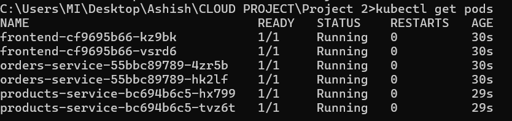
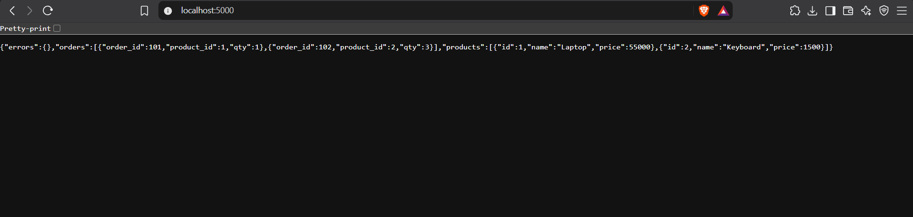
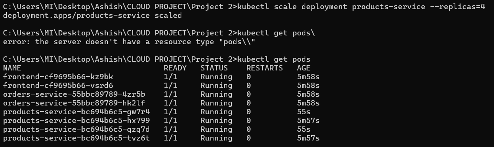
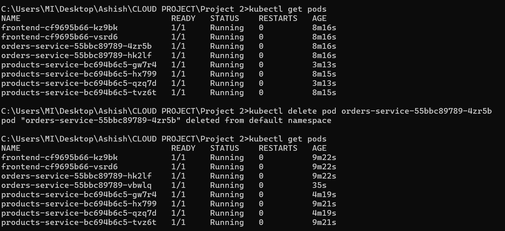

# Microservices on Kubernetes


Three small Flask services containerized with Docker and deployed to a local Kubernetes cluster (minikube).

```
Browser -> frontend -> products-service
                    -> orders-service
```

| Service | Port | Endpoints |
|---------|------|-----------|
| frontend | 5000 | `/` (combines products and orders), `/health` |
| products-service | 5001 | `/products`, `/health` |
| orders-service | 5002 | `/orders`, `/health` |

## Tech stack
Python (Flask), Docker, Docker Compose, Kubernetes (minikube), GitHub Actions

## Run with Docker Compose
```
docker compose up -d --build
docker compose ps
```
Open http://localhost:5000, then stop with `docker compose down`.

## Deploy on Kubernetes (minikube)
```
minikube start --driver=docker
docker compose build
minikube image load products-service:1.0
minikube image load orders-service:1.0
minikube image load frontend:1.0
kubectl apply -f k8s/
kubectl get pods
kubectl port-forward svc/frontend 5000:5000
```
Open http://localhost:5000.

## Scaling and self-healing
```
kubectl scale deployment products-service --replicas=4
kubectl get pods
kubectl delete pod <one-products-pod-name>
kubectl get pods
```

## Design notes
- Services find each other by Kubernetes Service name (DNS), configured through environment variables.
- Readiness and liveness probes use `/health`, so traffic only reaches ready pods.
- Resource requests and limits are set on every container.
- Containers run as a non-root user.
- The frontend returns a 502 with an error message if a backend is down, instead of crashing.
- CI builds all three images and validates the manifests with kubeconform on every push.

## Screenshots

### Pods running


### App in the browser


### Scaling


### Self-healing


## What I learned
Write 3 or 4 points in your own words (service discovery, probes, scaling, debugging).
